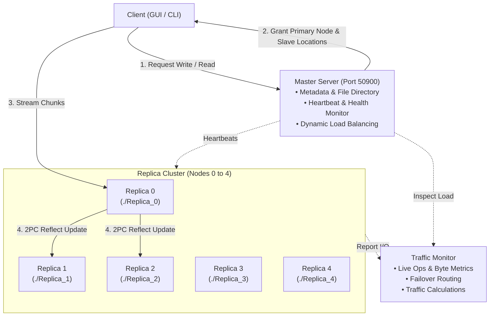

# Distributed File System (Java RMI - GFS Architecture)

A robust, fault-tolerant Distributed File System inspired by the [Google File System (GFS)](https://en.wikipedia.org/wiki/Google_File_System) built using **Java Remote Method Invocation (RMI)**. 

The system features automatic two-phase commit (2PC) replication, ACID transaction guarantees, dynamic traffic load balancing, automated failover rerouting, a full-featured Swing desktop GUI, and support for local file uploads with real-time cluster traffic calculation.

---

## 🌟 Key Highlights & Features

- **Strict 5-Replica Node Architecture:** Cluster topology with 5 dedicated replica nodes (`Replica_0` to `Replica_4`) and 1 central Master Server (Port 50900).
- **📁 Local File Upload & Dynamic Traffic Distribution:**
  - Upload arbitrary local files (PDFs, images, documents, binary, text) directly to the DFS cluster.
  - Files are automatically sliced into streaming chunks with customizable or adaptive chunk sizes.
  - **Dynamic Load Balancing:** The Master server inspects live replica workloads and dynamically selects the least-loaded alive replica as the Primary Node.
  - **Real-Time Traffic Plan Preview:** Visualizes per-node traffic share percentage, streaming chunk counts, slave replication workload, and transfer progress bars.
- **⚡ Fault Tolerance & Failure Simulation:**
  - **Simulate Failure / Revive Node:** Take any replica offline with a single click or command to simulate node crashes.
  - Offline nodes reject remote calls with realistic network exceptions.
  - **Automatic Traffic Rerouting:** Reads and writes automatically fail over to surviving replicas with zero data loss.
  - **Sole Survivor Mode:** If 4 of 5 replicas fail, 100% of the cluster traffic and file availability is transparently absorbed and preserved by the surviving node.
- **💾 Local Disk Export:** Read and export any file stored in the distributed cluster back onto the host file system.
- **ACID Guarantees & 2-Phase Commit (2PC):**
  - Chunks are streamed with sequence numbers and acknowledgments.
  - Atomic commit reflects updates across replica slaves before locks are released.
- **Dual Interfaces:**
  - Modern desktop Swing GUI with live dashboards, visual chunk breakdown, and test runners.
  - Interactive terminal CLI with shell commands.

---

## 🏗️ System Architecture



### Components

1. **Master Server (`Master.java`):**
   - Maintains cluster directory mappings: file-to-replica locations (`filesLocationMap`) and file-to-primary replica mappings (`primaryReplicaMap`).
   - Runs heartbeat background tasks checking replica node liveness.
   - Selects primary replicas based on lowest cumulative traffic load (`TrafficMonitor.getTotalOps`).
   - Re-elects new primary replicas upon node failure and initiates file healing.

2. **Replica Server (`ReplicaServer.java`):**
   - Manages local chunk storage inside dedicated directories (`./Replica_0` ... `./Replica_4`).
   - Buffers write chunks by transaction ID and sequence number.
   - Coordinates two-phase commit across slave replicas with read-write locks (`ReentrantReadWriteLock`).
   - Implements an explicit `alive` state that rejects calls with `RemoteException` during failure simulation.

3. **Traffic Monitor (`TrafficMonitor.java`):**
   - Tracks operational metrics (read ops, write ops, bytes transferred, last active timestamp) per node.
   - Dynamically calculates failover target mappings when nodes go down.
   - Pre-computes file upload traffic distribution plans (`FileTrafficPlan`).

4. **Client (`Client.java`):**
   - Interacts with Master to request read/write authorizations.
   - Streams chunks sequentially to the designated Primary Replica.
   - Automatically detects failed nodes during reads and fails over to surviving replicas.

---

## 🖥️ Desktop GUI Studio

Launch via `run_gui.bat`:

| Tab | Feature | Description |
|---|---|---|
| **1. 🖥️ Cluster Nodes & Traffic** | **Live Node Cards** | Shows real-time status (`ONLINE`, `SOLE SURVIVOR`, `ABSORBING`, `OFFLINE`), storage size, reads/writes, and traffic reroute targets. |
| | **Simulate Failure / Revive** | Toggle any node's failure state asynchronously without blocking the UI. |
| | **Failover Routing Banner** | Displays active traffic diversion routes across the cluster. |
| **2. 📁 Files & Availability** | **Files Registry** | Shows hosted replicas, primary replica, healthy copies, and availability status (`100% HA`, `Degraded`, `0% Offline`). |
| | **Visual Chunk Breakdown** | Inspects chunk sequences, hex dump, raw string data, and replica storage locations. |
| | **Export to Local Disk** | Downloads any distributed file to a local destination file. |
| **3. ✍️ Write & Commit Studio** | **Browse & Upload File** | File dialog to select any local file (PDF, TXT, images, binaries). |
| | **Chunk Size Selector** | Choose between Adaptive Auto-tune, 3 B (GFS default), 64 B, 256 B, or 1024 B. |
| | **Traffic Distribution Matrix** | Real-time calculation showing primary replica assignment, slave nodes, workload %, and progress bars. |
| | **Stream & Commit** | Slices the file into chunks, streams to primary node with progress bar, and commits across replicas. |
| **4. 🧪 Automated Tests** | **Test Suites** | One-click runners for Multi-Client Demo, Node Failover Test, Concurrency Test, and Batch Operations. |

---

## 🚀 Quick Start

### Prerequisites
- **Java JDK 8 or higher** (OpenJDK 11, 17, 21, or 25 supported).
- Windows OS (batch files provided; can also run on Linux/macOS via standard shell commands).

### Option 1: Launch the Desktop GUI
Double-click `run_gui.bat` or run in terminal:
```cmd
.\run_gui.bat
```

### Option 2: Launch the Console CLI
Double-click `run.bat` or run:
```cmd
.\run.bat
```

### Option 3: Manual Compilation & Execution
```cmd
# Compile all source files into bin/
javac -d bin src/*.java

# Run Desktop GUI
java -cp bin DFSGui

# Run Console CLI
java -cp bin Main
```

---

## ⌨️ Interactive CLI Commands

When running `Main.java` in console mode, the following commands are available at the `dfs>` prompt:

| Command | Description | Example |
|---|---|---|
| `upload <filepath>` | Slices local file, calculates traffic distribution plan, and uploads to DFS | `upload test.pdf` |
| `write <filename> <text>` | Writes text directly to a DFS file | `write notes.txt Distributed Systems Lab` |
| `read <filename>` | Reads and displays file content from DFS | `read notes.txt` |
| `gui` | Opens the Desktop GUI from the CLI | `gui` |
| `custom` | Executes the concurrent write/commit test scenario | `custom` |
| `exit` / `quit` | Shuts down DFS servers and exits | `exit` |

---

## 🧪 Testing Scenarios

1. **Simulate Node Failure & Automatic Failover:**
   - In the GUI, open Tab 1 and click **"⚠️ Simulate Failure"** on Replica 1.
   - The card switches to **"● OFFLINE (FAILED)"** and the button changes to **"✅ Revive Node"**.
   - Open Tab 3, browse any file, and notice that traffic calculation automatically routes traffic exclusively to surviving nodes (skipping Replica 1).
   - In Tab 4, click **"⚡ Test Node Failover"** to run an automated end-to-end failover test.
2. **Dynamic Traffic Balancing:**
   - Upload multiple files via Tab 3.
   - The system dynamically alternates the Primary Replica designation to the least-loaded node, balancing traffic evenly across the cluster.
3. **Sole Survivor High Availability:**
   - Click "Simulate Failure" on 4 out of 5 nodes.
   - The remaining node becomes the **"🏆 SOLE SURVIVOR"**, absorbing 100% of cluster traffic and allowing continued reads and writes.

---

## 📁 Project Structure

```text
Distributed-File-System-based-on-Java-RMI-master/
├── src/
│   ├── Client.java                     # Client implementation for DFS operations
│   ├── Configurations.java             # System constants (ports, chunk size, replication factor)
│   ├── DFSGui.java                     # Desktop GUI interface (Swing)
│   ├── FileContent.java                # Serializable file and chunk payload container
│   ├── Main.java                       # Main entry point and interactive CLI
│   ├── Master.java                     # Master Server implementation (metadata, failover, balancing)
│   ├── MasterServerClientInterface.java # Remote interface for Master Server
│   ├── MessageNotFoundException.java   # Exception for missing transaction messages
│   ├── ReplicaInterface.java           # Remote interface for Replica Servers
│   ├── ReplicaLoc.java                 # Replica location metadata (ID, address, alive state)
│   ├── ReplicaReplicaInterface.java    # Inter-replica remote communication interface
│   ├── ReplicaServer.java              # Replica node implementation (storage, 2PC commit, locks)
│   ├── ReplicaServerClientInterface.java# Client-to-replica remote interface
│   ├── TrafficMonitor.java             # Traffic tracking, calculations, and failover router
│   ├── WriteAck.java                   # Transaction write authorization acknowledgment
│   └── ChunkAck.java                   # Chunk sequence receipt acknowledgment
├── Replica_0/ ... Replica_4/           # Physical storage folders for each replica node
├── repServers.txt                      # Cluster node network configuration
├── run_gui.bat                         # Launcher for Desktop GUI
├── run.bat                             # Launcher for Console CLI
└── README.md                           # Project documentation
```